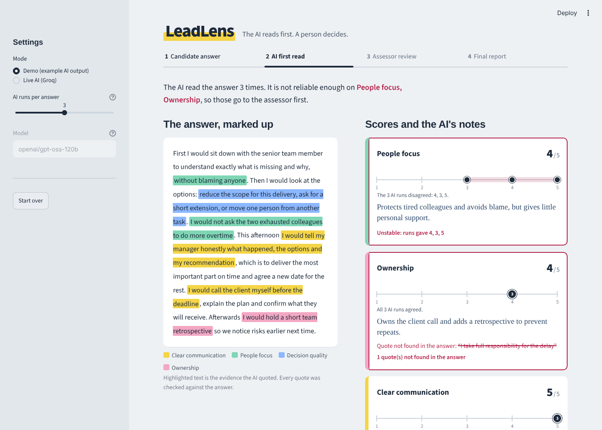

# LeadLens: AI-assisted leadership assessment, with a human in the loop

**The question:** How can AI make assessments faster and smarter, without losing the human judgment that makes them valuable?

**My answer in one line:** let the AI do the first read, make it *prove* every score with evidence, measure how much it disagrees with itself, and send the uncertain parts to a human, who always makes the final call.

## What it does

1. **Candidate answer.** A person answers a written leadership scenario (missed deadline, team conflict, rolling out an AI tool).
2. **AI assessment.** An LLM scores the answer on four competencies against a written rubric with behavioural anchors (1 / 3 / 5). It scores the same answer **several times**.
3. **The app checks the AI.**
   - **Evidence check:** every score must quote the candidate. The app verifies each quote really appears in the answer. Invented quotes are marked ❌.
   - **Consistency check:** if the runs disagree (e.g. 4, 3, 5), the competency is flagged as unstable. One run is weak evidence.
4. **Assessor review.** Flagged items come first. The assessor sets the final score, and must give a reason when they change the AI's score.
5. **Report.** Final scores, AI vs. human, every override and its reason. Download as Markdown or JSON.



## Why it is built this way

- **Faster:** the assessor reviews a structured first read with evidence, instead of starting from a blank page.
- **Smarter:** the overrides and their reasons are data. Over time they show where the rubric is unclear or where the AI is systematically wrong.
- **Human judgment stays:** the AI never sets a final score. It also says *where* it should not be trusted, so human time goes where it matters.

## Run it

```bash
pip install -r requirements.txt
streamlit run app.py
```

- **Demo mode** works without any key. It uses prepared example AI output for the first two scenarios, built to show the checks working (one unstable competency, one invented quote).
- **Live mode** uses a free [Groq](https://console.groq.com) API key (Llama 3.3 70B). Enter it in the sidebar, or set `GROQ_API_KEY` as an environment variable or Streamlit secret.

Tests: `python -m pytest -q`

## What I would do next

- Test with real assessors: how often do they agree with the AI, and are the flags the right ones?
- Compare AI and human scores on a set of real (anonymised) answers before using it for any decision.
- Add a candidate-facing feedback view, written from the final human scores.
- Check for bias: do scores change when only the writing style or language level changes?

## Files

| File | Purpose |
|---|---|
| `app.py` | Streamlit app, four steps |
| `assessor.py` | Prompt, LLM call, output parsing, evidence and consistency checks |
| `scenarios.py` | Scenarios and the competency rubric |
| `demo_data.py` | Example AI output for demo mode |
| `test_assessor.py` | Tests for the checks |

